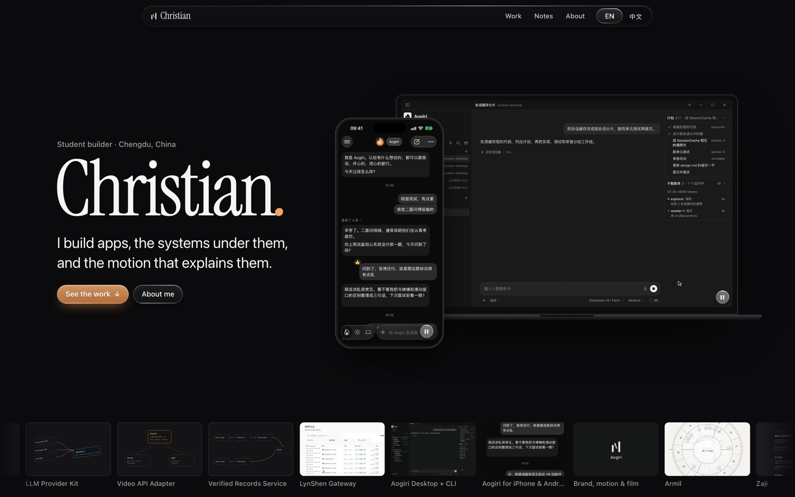
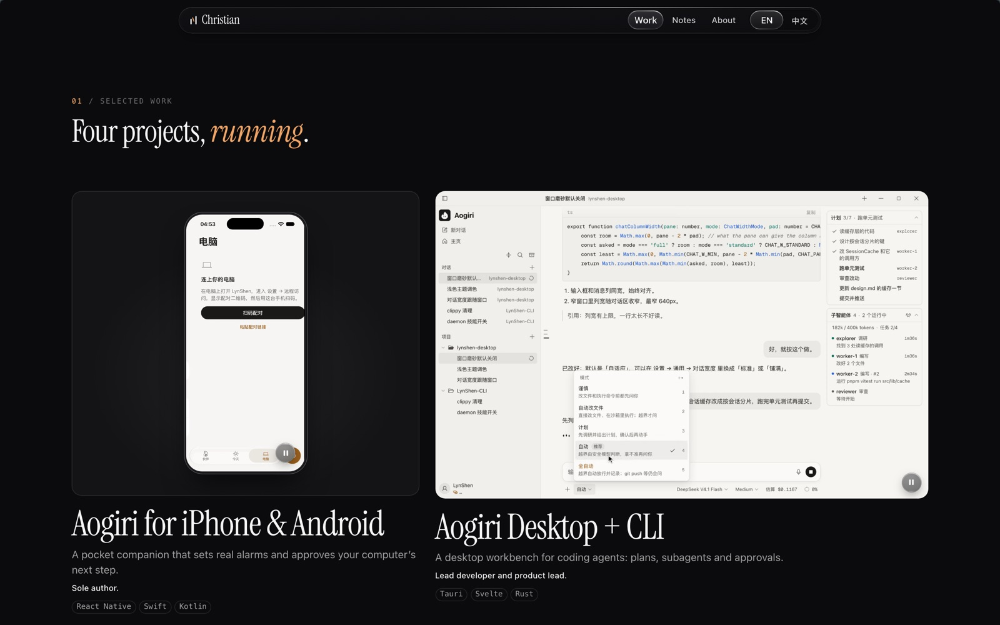
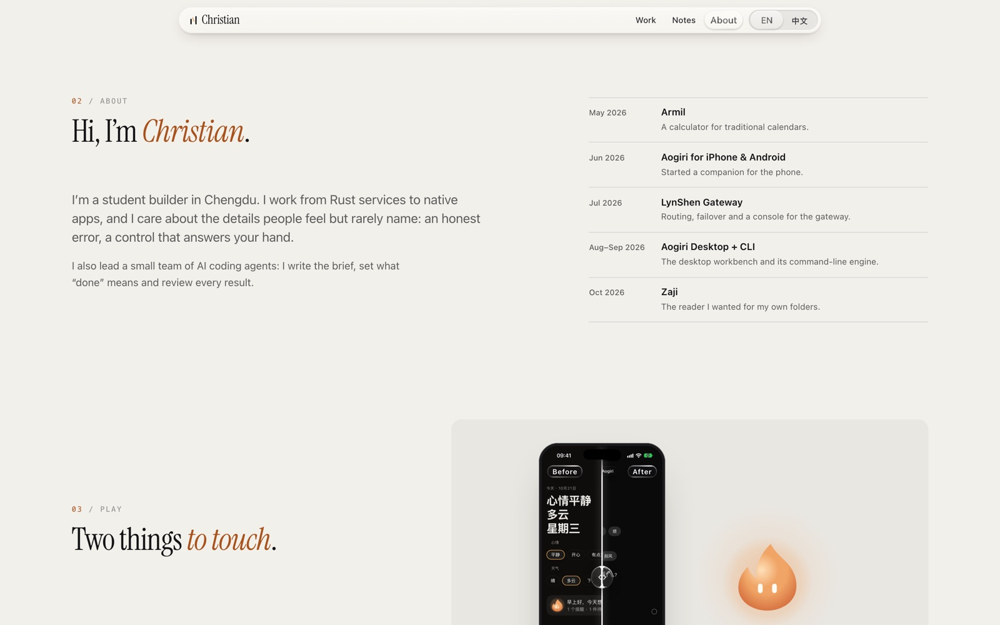
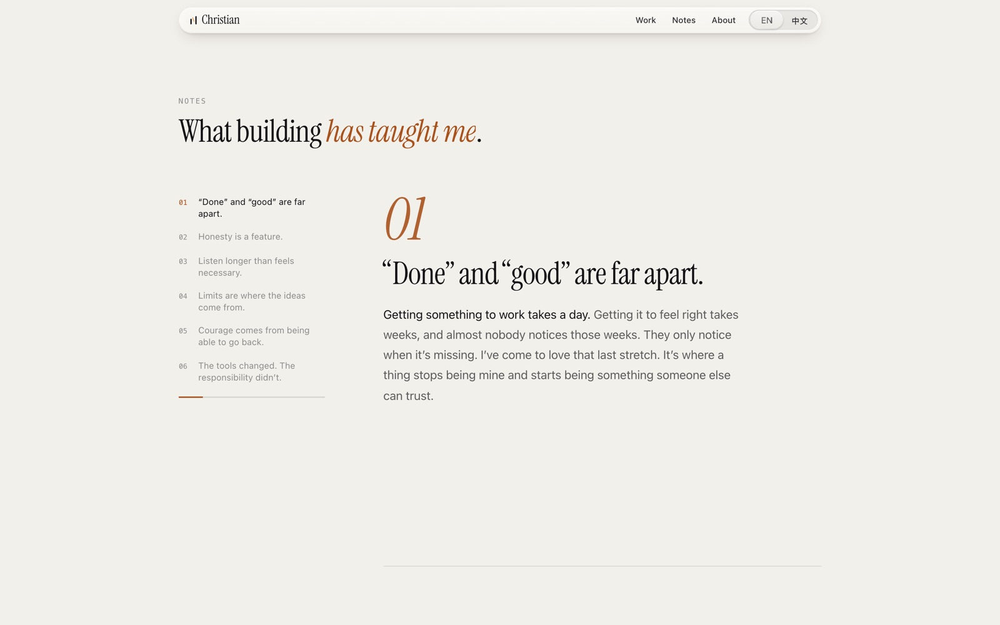
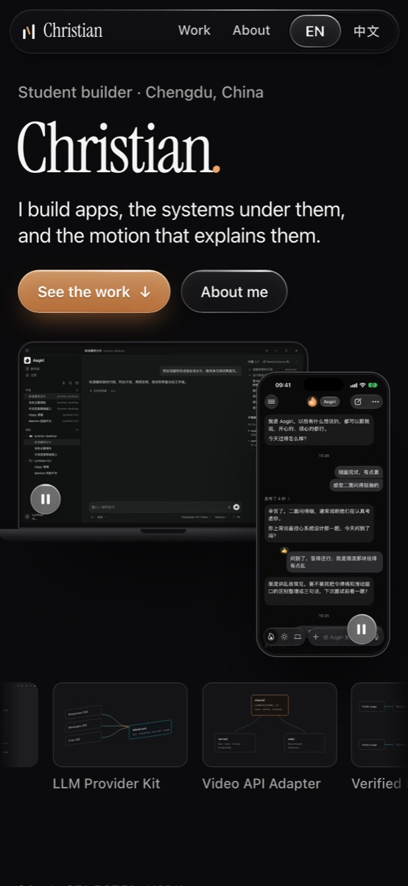

<div align="center">

# Chris's Channel

The source of my personal site, [persona.imlibra.org](https://persona.imlibra.org)

English · [中文](README.zh-CN.md)

</div>



I'm Christian. I'm a student in Chengdu, and I make apps. More often than not I end up making the parts under them too: the services they talk to, the engine that does the actual work, and the small animations that tell you what just happened.

INFJ, Libra. The part of making things I like best is the last stretch, the weeks between "it works" and "it feels right" that almost nobody notices.

This site keeps all of that in one place. There are nine projects, and each has its own page that says which parts I made and what I learned. There are six short notes about building things. There is also a timeline that starts in May 2026, when I began the first of them.

The whole site is in English and in Chinese. I wrote the Chinese myself rather than running it through a translator, so the two versions don't match word for word.

## A look around



<p>
  
  
</p>

<p align="center">
  
</p>

## What I was careful about

Every picture of an app is the real app with demo data in it. Nothing is a drawn mockup.

If your device asks for reduced motion, the site goes still: no scroll effects, and no video plays by itself.

You can get around with just a keyboard, and every video has a pause button.

## Changes

- **2026-10-27** Opened this repository.
- **2026-10-25** Retook the Zaji screens from version 1.3.0 and linked the official sites.
- **2026-10-23** First version online. Later that day, a new layout: a dark first screen, the main projects as a mosaic, and a timeline. Armil joined the projects.
- **2026-10-21** Started.

## Running it

You need Node 22 or newer.

```sh
npm install
npm run dev
```

Then open http://127.0.0.1:4321. How the images and videos are made, and how I check the pages, is in [docs/maintaining.md](docs/maintaining.md).

## Rights

© 2026 Christian. You're welcome to read the code and learn from it. If you'd like to reuse part of it, just ask. The writing, screenshots, recordings, logos and the film are mine and aren't licensed for reuse.

The Instrument Serif typeface is used under the SIL Open Font License ([public/fonts/OFL.txt](public/fonts/OFL.txt)).
