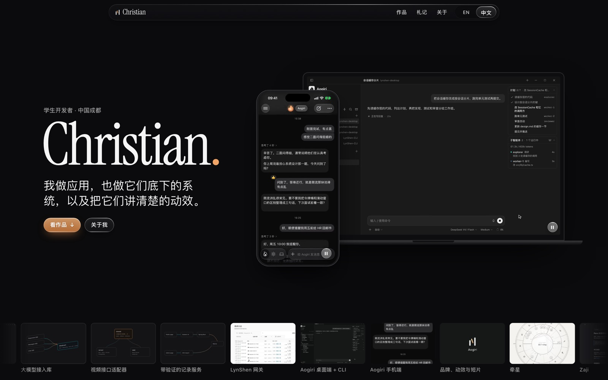
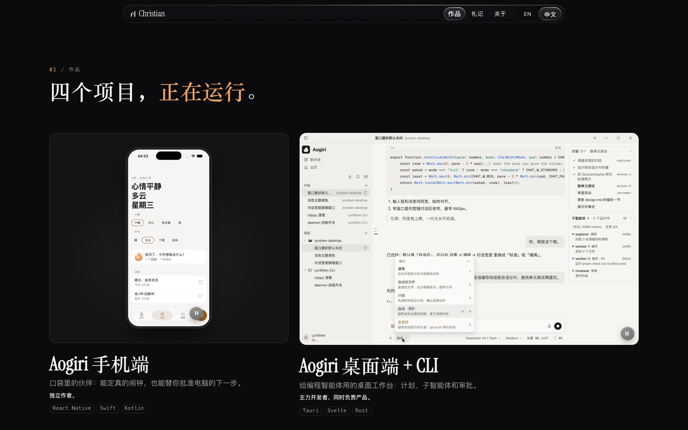
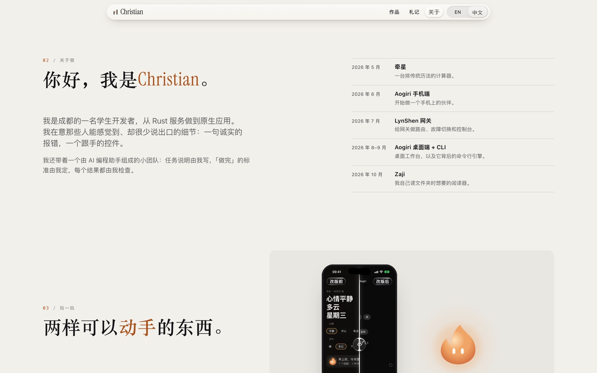
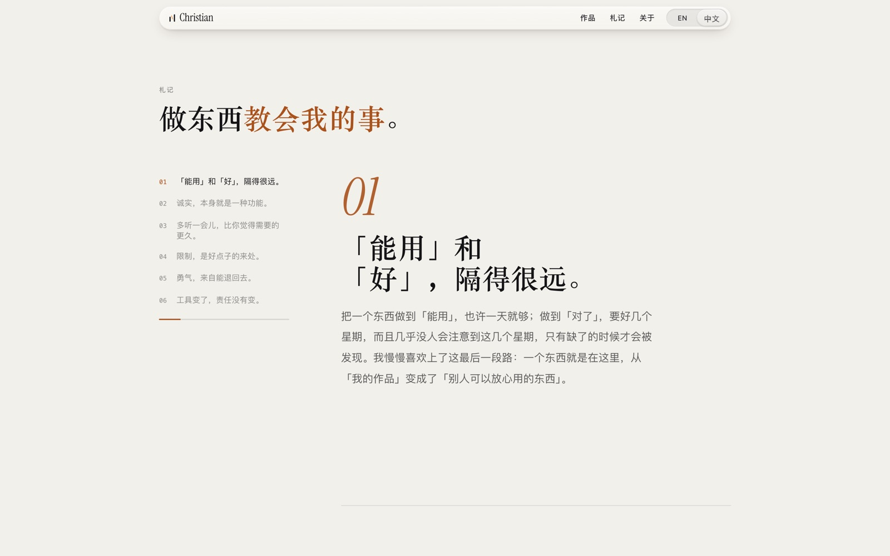
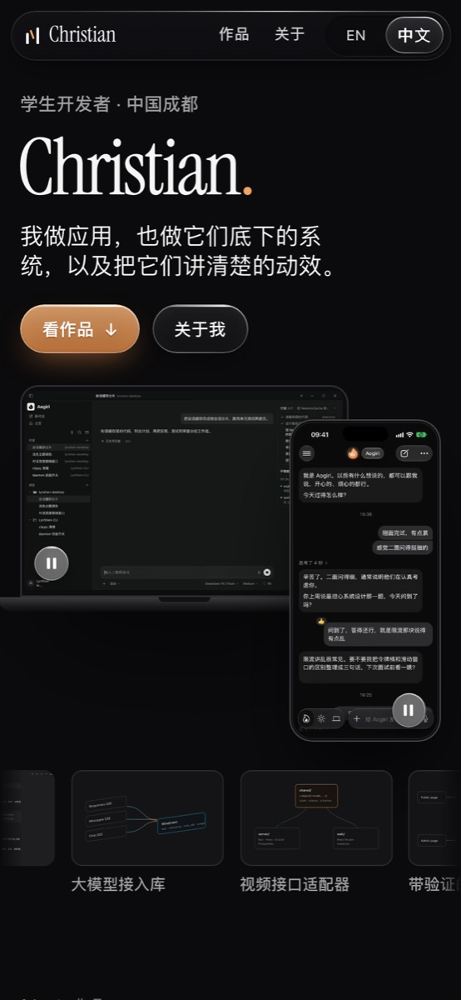

<div align="center">

# Chris's Channel

我的个人网站 [persona.imlibra.org](https://persona.imlibra.org) 的源码

[English](README.md) · 中文

</div>



我叫 Christian，在成都读书，平时做应用。做着做着，常常连它底下的东西也一起做了：它要连的服务，真正干活的引擎，还有那些告诉你「刚才发生了什么」的小动画。

INFJ，天秤座。做东西时我最喜欢最后那一段：从「能用」到「对了」的那几个星期，几乎没人注意，却决定了一个东西值不值得信任。

这个网站把这些放在了一起。九个项目，每个都有自己的一页，写清楚哪些部分是我做的，做完学到了什么；六篇短短的札记，讲做东西这件事；还有一条时间线，从 2026 年 5 月我开始做第一个项目算起。

网站有中文和英文两个版本。中文是我自己一句一句写的，没有交给翻译工具，所以两边不会逐字对应。

## 看看



<p>
  
  
</p>

<p align="center">
  
</p>

## 我比较在意的几件事

所有应用的画面都是真实的应用，里面放的是演示数据，没有一张是画出来的假界面。

如果你的设备打开了「减弱动态效果」，网站会安静下来：滚动没有动画，视频也不会自己播放。

只用键盘也能浏览全站，每一段视频都有暂停按钮。

## 更新记录

- **2026-10-27** 把这个仓库公开。
- **2026-10-25** 用 Zaji 1.3.0 重拍了它的截图，加上各个产品的官网链接。
- **2026-10-23** 第一版上线。当天又换了新布局：深色首屏、主要作品拼在一起展示、一条时间线。牵星（Armil）加入。
- **2026-10-21** 开始做。

## 在本地运行

需要 Node 22 或更新的版本。

```sh
npm install
npm run dev
```

然后打开 http://127.0.0.1:4321。图片和视频怎么生成、页面怎么检查，写在 [docs/maintaining.md](docs/maintaining.md)（英文）。

## 版权

© 2026 Christian。欢迎读这些代码，从中学点什么。如果想直接拿去用某一部分，跟我说一声就好。文字、截图、录屏、标志和短片都属于我，不授权转用。

Instrument Serif 字体按 SIL Open Font License 使用（[public/fonts/OFL.txt](public/fonts/OFL.txt)）。
